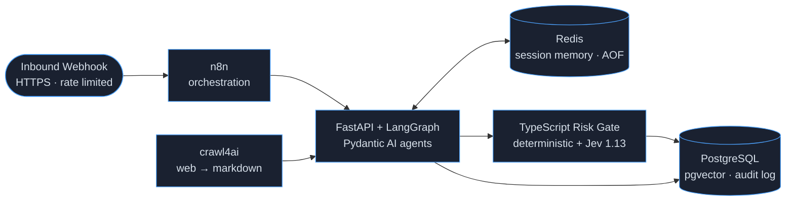

# Polyglot AI Stack — RAG · Stateful Agents · Deterministic Risk Gate

> **Case study.** A production-grade AI automation platform mixing Python and
> TypeScript: retrieval-augmented generation over live websites, stateful LLM
> agents with persistent memory, and an explainable risk & policy gate with an
> optional probabilistic decision-model overlay. All numbers on this page were
> measured on the live system.

<p align="center">
  <b>Live:</b> <a href="https://nukethemaii.github.io/ai-command-center/">GitHub Pages dashboard</a> ·
  <a href="https://ai.earngrid.site/">VPS case study</a><br>
  <i>Deployed on a single VPS with Docker — 6 containers, ~4 GB RAM budget.</i>
</p>

<p align="center">
  
  
  
  
  <br><sub>live badges — refreshed from the running system every 30 min by GitHub Actions</sub>
</p>

---

## Problem

Businesses want AI that does real work: answer questions grounded in their own
documentation, qualify inbound leads automatically, and apply consistent risk
policy before anything is committed. Most demos stop at a chat box. Production
needs retrieval quality, persistent state, deterministic policy enforcement,
full auditability, and hard cost control — in one coherent pipeline.

## Architecture



| Service | Technology | Responsibility |
|---|---|---|
| orchestration | n8n | webhook fan-out, orchestration, audit write |
| agent-api | Python 3.12 · FastAPI · LangGraph · Pydantic AI | RAG pipeline, stateful lead qualifier, session memory |
| risk engine | TypeScript · Node 22 | deterministic risk & policy gate + decision-model overlay |
| data | PostgreSQL 16 · pgvector | 1536-dim embeddings (HNSW), immutable audit trail |
| memory | Redis 7 · AOF | per-session conversation memory |
| ingestion | Playwright-based crawler | website → clean Markdown |

## The three engines

### 1 · RAG over live websites
- Any URL → clean Markdown → paragraph-aware chunking → embeddings (1536-dim).
- pgvector + HNSW cosine index for millisecond similarity search.
- Grounded answers with numbered source citations; the model is instructed to
  say "the context doesn't cover this" rather than invent facts.

### 2 · Stateful lead-qualification agent
- LangGraph state machine → structured output (score, category, urgency,
  next action, reply), persisted per session in Redis (7-day TTL).
- Provider-resilient routing: primary + fallback LLM providers, retry with
  backoff, explicit failures instead of ever returning fake data.

### 3 · Deterministic risk & policy gate (TypeScript)
- Pure, explainable functions: documented additive risk model → 0–100 score,
  per-gate pass/fail, machine-readable reason codes.
- Optional TypeSafe "System One" overlay: typed questions (score / choice /
  yes-no) with strict response validation (probability sums, top-choice margin
  checks, no confidence field on binary answers).
- **Fail-open by design**: the deterministic gate is the authority; the model
  layer annotates and can never block or fabricate.

## API contracts (shapes)

```bash
POST /demo/rag-ingest   {"url": "..."}                    → {"chunks_stored": N}
POST /demo/rag-ask      {"query": "...", "top_k": 3}      → {"answer": "...", "sources": [...]}
POST /demo/agent-webhook{"session_id": "...", "message": "..."}
                        → {"qualification": {...}, "risk_gate": {...}, "timings": {...}}
POST /decision/evaluate {"features": {...}, "qualification": {...}}
                        → {"decision": "pass|fail", "risk_score": 19.8,
                           "reason_codes": ["ALL_GATES_PASSED"], "gates": [...]}
```

## Benchmarks

All measured live on the deployed system — not estimates.

| Metric | Value | Notes |
|---|---|---|
| Decision-model latency (Jev 1.13) | **548 ms** | 3-question fan-out, measured live |
| Cost per model decision | **$0.0000213** | provider-billed `usage.cost` (507 in / 73 out tokens) |
| Deterministic gate | **< 25 ms** | in-network, zero external calls |
| Embeddings | **1536-dim** | HNSW cosine index |
| End-to-end lead chain | **~1–2 s** | webhook → orchestration → LLM → gate → audit |
| Topology | **6 containers** | isolated bridge network, memory caps, log rotation |

## Deployment model

The platform ships as a **private, image-based installer** — prebuilt Docker
images plus a one-command install script (preflight checks, generated secrets,
health-gated bring-up, port shifting, safe uninstall with data backup). The
application source is proprietary and not distributed publicly; this repository
contains the case study, live telemetry, and documentation only.

## Security posture

- Databases and internal services bound to loopback; container traffic on a
  private bridge only — raw DB ports never public.
- AI endpoints are token-guarded **and** edge rate limited (5 req/s, burst 10):
  a leaked token cannot burn model credits at scale.
- Public surfaces are strictly read-only via a cached, sanitized stats endpoint.
- One root-restricted environment file holds all secrets; nothing in code or
  images. Prebuilt images are distributed through a private channel only.

## What I learned

- **pgvector pitfalls**: explicit `%s::vector` casts with psycopg3; ivfflat
  built on an empty table silently matches zero rows forever (use HNSW for
  incremental fills).
- **LangGraph drops undeclared TypedDict keys** between nodes — declare every
  inter-node field.
- **pydantic-ai 2.x** model construction moved to `provider=OpenAIProvider(...)`;
  `run_sync` must not run inside an async server's event loop.
- **Workflow-engine activation** requires the publish registry, not just an
  `active` flag — and the published version runs a stored snapshot.
- **Decision-model APIs reject chat/completions** — dedicated endpoints,
  versioned slugs, strict validation of probability sums and margins; error
  bodies can echo requests, so never log them.
- **Fail-open > fail-pretty**: a deterministic authority plus annotating model
  layers survives outages without lying to users.

---

*Portfolio case study — built and verified with live traffic end-to-end.
Interested in a similar build? Reach out via Upwork.*
